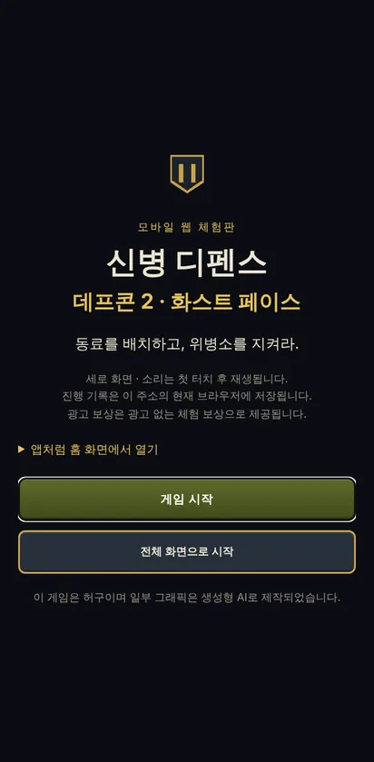
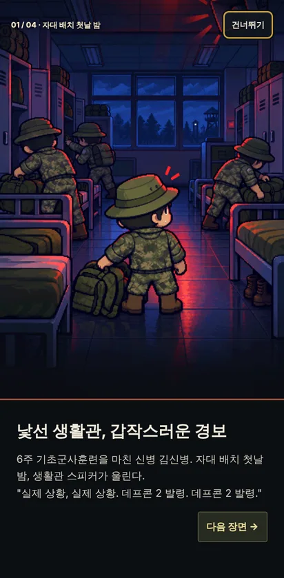
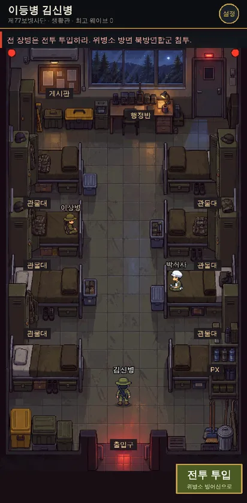
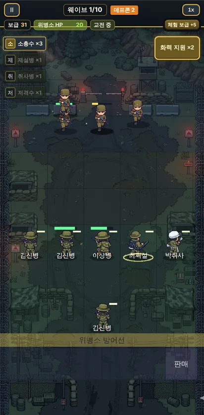
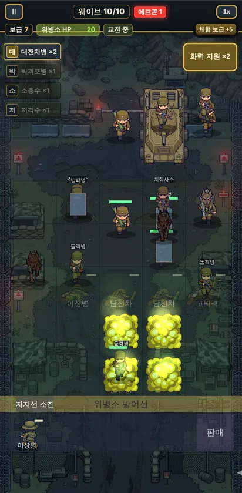

# 신병 디펜스

> 자대 배치 첫날 밤, 데프콘 2가 발령되고 위병소가 뚫린다.
> 동료 병사 카드를 5열 차선에 배치하고, 같은 카드를 겹쳐 **짬(계급)** 을 올리며 10개 웨이브를 막는 **세로형 카드 디펜스**.

**▶ [휴대폰 브라우저에서 바로 플레이](https://newbie-defense.vercel.app)** · 세로 화면 · 설치 없음

| 타이틀 | 브리핑 | 생활관 | 전투 | 10웨이브 |
|:---:|:---:|:---:|:---:|:---:|
|  |  |  |  |  |

> 이 저장소는 **PUBLIC**이다. 키·토큰·키스토어·테스터 이메일·그림 원본 PNG를 올리지 않는다.
> 새 컴퓨터이거나 앱을 다시 설치했다면 먼저 `docs/SETUP.md`, 이어서 작업한다면 `docs/HANDOFF.md`를 읽는다.

---

## 게임 소개

### 한 판의 흐름

1. **성명 입력 → 브리핑 4컷**: "실제 상황, 실제 상황. 데프콘 2 발령."
2. **생활관**: 빈 바닥을 드래그해 걷고, 동료와 대화하고, `전투 투입`으로 위병소 방어선에 나간다.
3. **준비 단계**: 상점에서 카드를 사고(보급), 리롤하고, 끌어서 배치하고, 지뢰를 묻는다.
4. **전투 단계**: 병사들이 사거리 안의 적을 스스로 공격한다. 화력 지원 버튼과 2배속이 있다.
5. 이 과정을 **10웨이브** 동안 반복한다. 후반에는 데프콘 1로 올라가고, 장갑차가 나온다.

### 핵심 재미

| | 내용 |
|---|---|
| **조합** | 카드마다 대신할 수 없는 역할이 있다. 그 역할이 빠지면 특정 웨이브가 뚫린다. |
| **짬 합성** | 같은 카드 2장을 겹치면 진급한다(이등병 → 일병 → 상병 → 병장). 일병이 되면 특기 2개 중 하나를 고른다. |
| **흩을까, 합칠까** | 시너지는 같은 보직의 **인원 수**로 센다. 합치면 강해지지만 인원이 줄어 시너지가 꺼진다. |

### 보직 카드 10종

| 카드 | 인물 | 역할 |
|---|---|---|
| 소총수(K2) | {플레이어 이름} | 기본 딜러 |
| 저격수(K14) | 이상병 | 같은 열의 적을 모두 관통 |
| 제설병(송풍기) | 최제설 | 밀어내기 · 취약 · 도발 |
| 취사병 | 박취사 | 회복 · "짬밥"으로 최대 HP 증가 |
| 지뢰설치병 | 조지뢰 | 웨이브 전에 지뢰 매설 |
| 화학병 | 한화학 | 가스 제독 · 방독면 |
| 의무병 | 윤의무 | 쓰러진 아군 소생 |
| 박격포병 | 고박격 | 범위 포격 |
| 대전차병 | 남전차 | 장갑 피해 ×2 |
| 통신병 | 송통신 | 공격 속도 버프 · 화력 지원 +1 |

**적(북방연합군):** 보병 · 군견 · 강화 군견 · RPG병 · 돌격병 · 방패병 · 지정사수 · 장갑차(보스)

### 세계관과 원칙

- **진지한 가상 전쟁극**이 바탕이고, 군 생활 디테일(짬, 화스트 페이스, 짬밥)은 양념으로만 쓴다.
- **피 표현이 없다.** 쓰러지면 털썩 넘어지고 페이드아웃된다. 군 비하나 가혹행위는 웃음 소재로 쓰지 않는다.
- 적은 **가상 국가 "북방연합"** 이다. 부대와 마크도 가상이다. 한국군 제식 장비 이름(K2, K14 등)만 실제 이름을 쓴다.
- 광고는 **보상형만** 쓴다. 웹 체험판에서는 광고 없이 체험 보상으로 대신한다.
- 화면에 "이 게임은 허구" 고지와 생성형 AI 사용 고지를 둔다.

---

## 기술

| 항목 | 선택 |
|---|---|
| 언어 · 번들러 | TypeScript · Vite |
| 게임 엔진 | Phaser 4.2.1 (버전 고정) |
| 메뉴 UI | 순수 DOM + CSS (React 없음) |
| 앱 포장 | Capacitor 8 (Android). 웹 체험판은 Vercel |
| 저장 | `@capacitor/preferences`(앱) / `localStorage`(웹) |
| 광고 | AdMob 보상형(앱 전용) |
| 테스트 | Vitest: 규칙 순수 함수, 세이브, 광고 흐름, 에셋 계약 |

### 폴더 구조

```
src/
  rules.ts  data.ts  stages.ts   전투 규칙(순수 함수) · 카드·적 수치 · 웨이브 표  ← 레인 A
  battle/                        BattleScene · 판 · 유닛 · 적 · 상점 · 가스 · 이펙트 ← 레인 A
  ui/                            로비 · 화면 전환 · 걷는 생활관 · 보행 모션 (DOM)  ← 레인 B
  platform.ts save.ts audio.ts ads.ts device.ts web.ts   Capacitor · 저장 · 소리 · 광고 · 웹 체험판
public/assets/                   캐릭터 시트 · 카드 · 배경 · 효과음 · 배경음
tests/                           Vitest
docs/                            기획(GDD) · 기술(TECH) · 아트(ART) · 로드맵 · 티켓 · 리뷰 · 인계
scripts/harness/                 에이전트 작업 통제 훅
```

- 수치는 `src/data.ts`와 `src/stages.ts`에만 둔다. 코드 안에 숫자를 박지 않는다.
- 레인 A(전투)와 레인 B(플랫폼·UI)는 `docs/TECH.md` §8의 고정된 함수 시그니처로만 연결된다.

### 실행

```sh
npm ci
npm run dev       # 개발 서버
npm run verify    # 타입 검사 + 테스트 + 에셋 검사 + 빌드 (배포도 이 명령으로 빌드한다)
```

**디버그 URL**(전체 목록은 `docs/TECH.md` §9)

| 파라미터 | 효과 |
|---|---|
| `?scene=battle` · `?scene=walk` · `?scene=gallery` | 전투 · 생활관 · 에셋 갤러리를 바로 연다 |
| `?wave=10&unlock=all&supply=99` | 웨이브 · 해금 · 보급 지정 |
| `?deck=rifle:2,sniper:1` | 대기석에 카드 지급 |
| `?seed=42` · `?god=1` · `?speed=2` | 난수 고정 · 위병소 무적 · 2배속 |
| `?safe=1` · `?fps=1` · `?fx=low` | Safe Area 표시 · FPS · 저사양 모드 |

### 배포

- 웹 체험판: **https://newbie-defense.vercel.app** (Vercel, `main` 병합 시 자동 배포. 빌드 명령 `npm run verify`). 자세한 내용은 `docs/WEB-DEPLOY.md`
- Android: Capacitor 디버그 APK까지 확인했다. 구글 플레이 출시(서명 AAB, 스토어 등록)는 보류 중이다.
- 패키지 ID는 `io.github.kidariseok.defcon2`이다. 이전 가제를 따른 이름이고, 스토어에 올리기 전까지는 바꿀 수 있다.

---

## 만든 과정

1인 개발 프로젝트다. 방향 결정, 그림 제작, 플레이테스트, PR 병합은 사람이 하고, 기획, 구현, 조사는 **AI 에이전트를 레인별로 나눠** 맡겼다.

| 날짜 (2026) | 단계 | 내용 |
|---|---|---|
| 10-17 | 시작 | 원안(GPT 마스터 플랜)을 검토해 「출동! 5분대기조」(횡스크롤 슈터)로 시작. 같은 날 세로 탑다운으로 전환 |
| 10-20 | **M0 · 방향 전환** | 레퍼런스 5종의 메커니즘을 역설계해 **카드 디펜스**로 전환. 새 GDD와 병렬 작업 하네스 구축 |
| 10-20~21 | M1 · M2 | 갤러리 뼈대 → 판·배치 → 전투 → 경제. **G0 리뷰**(에뮬레이터에서 세로 고정, Safe Area, 뒤로가기, 저장, 백그라운드 음소거 통과) |
| 10-22~24 | M3 | 화학전, 강화 군견, 화력 지원, 실제 그림, 전투 2.0(자율 타깃팅) |
| 10-25~28 | M6 | 모션 엔진과 모션 그림 62장, 계급·특기, 새 카드 4종, 전투 소리, 걷는 생활관 |
| 10-29~30 | 웹 체험판 | 모바일 웹 체험판을 Vercel에 배포. 적 3병과 추가, 렉 완화. **「신병 디펜스」로 이름 확정** |

### 에이전트 레인

| 레인 | 담당 | 소유 경로 |
|---|---|---|
| 기획 · 게이트 리뷰 | Claude Code (Opus) | `docs/`, `AGENTS.md`, 하네스 |
| A 코어 전투 | Claude Code (Sonnet) + GSD 단계 계획 | `src/rules.ts` `data.ts` `stages.ts` `src/battle/` |
| B 플랫폼 · UI | Antigravity (Gemini) | `src/ui/`, 플랫폼 파일, `android/`, `public/` |
| C 조사 | Antigravity (Flash) | `docs/research/<주제>.md` |
| D 아트 | 사람 + 이미지 생성 AI + Figma | `art/`, `public/assets/` |
| 인수 (10-25 이후) | Codex | Claude와 Antigravity 사용량이 소진된 뒤 `docs/HANDOFF.md`로 이어받음 |

### 작업 통제 장치

- **티켓 1개 = 대화 1개 = 워크트리 1개 = PR 1개.** `main`은 사람이 PR을 병합해야만 바뀐다.
- **Stop 훅**(`scripts/harness/stop-gate.mjs`): 에이전트가 작업을 끝내려 할 때 소유 경로 밖 변경, 허용되지 않은 의존성, 진행 기록 누락, `npm run verify` 실패를 검사한다. 어기면 다시 일하게 돌려보낸다.
- **명령 가드**(`cmd-guard.mjs`): 에이전트의 `git push`를 막는다.
- **자동 저장**(`autosave.mjs`): 매 턴 끝과 5분마다 지금 브랜치로 커밋하고 push한다(공용 컴퓨터와 재설치 대비).
- **게이트**: G0(실기기 기본 동작) → G1(재미, 군 경험 없는 지인 플레이) → G2(실제 그림, 외부 3명) → G3(비공개 테스트 12명 × 14일)

```sh
# 하네스 단독 점검
echo '{"terminationReason":"NO_TOOL_CALL"}' | node scripts/harness/stop-gate.mjs     # 변경이 없으면 {"decision":"stop"} (먼저 자동 저장을 한다)
echo '{"toolCall":{"name":"run_command","args":{"CommandLine":"git push"}}}' | node scripts/harness/cmd-guard.mjs   # git push는 deny
```

### 먼저 읽을 문서 (작업자용)

| 문서 | 내용 |
|---|---|
| `AGENTS.md` | 에이전트 규칙(Antigravity가 자동으로 읽는다) |
| `docs/HANDOFF.md` | 지금 상태 · 작업 큐 · 함정 (작업자가 바뀌면 가장 먼저) |
| `docs/GDD.md` | 게임 기획: 화면, 카드, 짬 합성, 시너지, 웨이브, 경제, 광고 |
| `docs/TECH.md` | 기술 구조, 레인 경계, 디버그 URL, 금지 목록 |
| `docs/ART.md` | 아트 규격, 에셋 계약, 에셋 요청 체크리스트 |
| `docs/ROADMAP.md` | 단계(M0~M5), 게이트, 레인, 하루 루틴 |
| `docs/WEB-DEPLOY.md` | 웹 체험판 배포와 휴대폰 실행 |
| `docs/PLAYTEST.md` | 플레이테스트 기록표 |
| `docs/references/` | 기획 근거: 요구사항, 레퍼런스 5종 역설계, OSINT 정리 |

---

이 게임은 허구이며 실제 인물·부대·사건과 관계없습니다. 일부 그래픽은 생성형 AI로 제작되었습니다.
