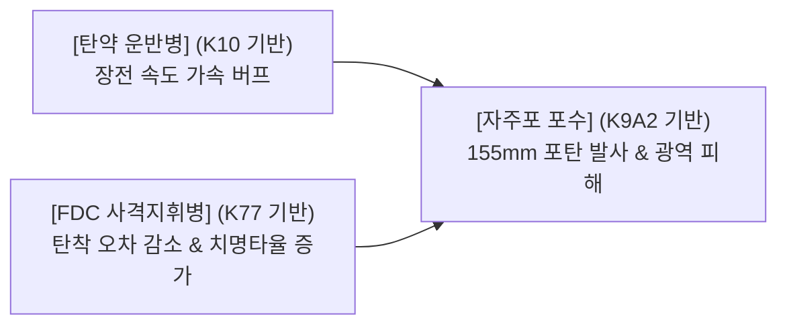

# 한국군 고증·은어·짬 문화·대드론·화생방·포병 조사 (R-102)

> 조사일: 2026-10-20, 모델: Antigravity (gemini-3.8-flash-medium). 사실(A/B/C)·추측·게임용 허구를 명확히 구분했다.

## 요약 (5줄 이내)

1. **계급·은어**: 대한민국 육군 병 계급은 이등병(2개월)·일병(6개월)·상병(6개월)·병장(4개월)의 18개월 복무 체계이며, 계급장 가로줄(1~4줄)과 짬 합성 시스템이 직관적으로 일치한다.
2. **보직 고증**: 취사병(야전취사트레일러 TR-400/대형삽), 제설병(엔진 송풍기/넉가래), 지뢰(대인 M14/KM18A1, 대전차 M15/M19), 화학병(K-CAM2, KM8K2, K5 방독면) 등 공개 장비와 병영 문화를 추출했다.
3. **적 화기 보강**: 북한군 보병분대 주력 직사화기인 7호 발사관(RPG-7), 대대급 82mm/60mm 박격포, 군견(저먼 셰퍼드), 서울 영공 침투 소형 무인기 사례를 공식 보도로 검증했다.
4. **M5 대드론·포병 체계**: 한국군 최신 차륜형 대공포 K30W 천호(30mm)와 세계 최초 실전 배치 레이저대공무기 Block-I(천광), K9A2(포수)·K10(탄약운반병)·K77(FDC) 삼각 편제를 게임 메커니즘으로 설계했다.
5. **규정 준수**: 군사 2급 비밀에 해당하는 작전계획, 기동로, 세부 매설 좌표, 사격제원 산출 소프트웨어 및 통신 주파수는 원천 배제하고 공개 출처(A/B 등급)만 수록했다.

---

## 확인 표

> **등급 기준**: A = 정부·국방부·방위사업청·법령 1차 공식 자료, B = 주요 언론·전문 안보 연구기관 보도, C = 일반 커뮤니티·백과사전 관용구 (수치 근거로는 미사용)

| 번호 | 항목 | 세부 내용 | 등급 | 출처(URL) | 확인일 |
|---|---|---|---|---|---|
| 1 | 병 계급장 규격 | 가로 4.5cm 세로 1cm 내외 가로줄 형태. 이등병 1줄, 일병 2줄, 상병 3줄, 병장 4줄. 전투복 포제 계급장은 흑색 자수 적용 | A | [국가법령정보센터 군인복제령 별표1](https://www.law.go.kr/법령/군인복제령) | 2026-10-20 |
| 2 | 병 복무기간 | 육군 18개월 복무 기준 진급 최저기간: 이등병 2개월, 일등병 6개월, 상등병 6개월, 병장 4개월(잔여기간) | A | [국가법령정보센터 군인사법 시행규칙 제34조](https://www.law.go.kr/법령/군인사법시행규칙) | 2026-10-20 |
| 3 | 데프콘 2 '화스트 페이스' | 방어준비태세 2단계 공식 훈련 용어(Fast Pace). 전쟁 임박 시 군장 결속, 실탄 불출, 편제 100% 충원, 전작권 연합사 이양 | B | [국방일보 안보칼럼/용어해설](https://kookbang.dema.mil.kr) | 2026-10-20 |
| 4 | 데프콘 1 '칵키드 피스톨' | 방어준비태세 1단계 공식 훈련 용어(Cocked Pistol). 공이치기를 당긴 권총 상태, 즉각 교전 개시 태세 | B | [국방일보 군사상식](https://kookbang.dema.mil.kr) | 2026-10-20 |
| 5 | 야전취사 장비 | 견인형 야전취사트레일러(TR-400, 300~400인분 조리) 및 최신 차량 탑재형 기동형 취사장비(냉장·취사 일체형) 운용 | A | [대한민국 정책브리핑 기동형 취사장비](https://www.korea.kr) | 2026-10-20 |
| 6 | 제설 장비 | 대대급 이상 제설 작전 시 배부식(배낭형) 엔진 송풍기, 플라스틱/알루미늄 넉가래, 싸리빗자루, 제설삽 집중 투입 | B | [국방일보 전방부대 혹한기 제설작전 보도](https://kookbang.dema.mil.kr) | 2026-10-20 |
| 7 | 한국군 대인지뢰 | M14(KM14) 플라스틱 발목지뢰(112g 폭풍형), M16A2 도약식 파편지뢰, KM18A1 수평세열지향성지뢰(클레이모어) | B | [국방일보 공병부대 실물지뢰 폭파훈련](https://kookbang.dema.mil.kr) | 2026-10-20 |
| 8 | 한국군 대전차지뢰 | M15 중금속 대전차지뢰, M19 비금속(플라스틱) 대전차지뢰(최소 금속 부품 탐지 회피) | B | [국방일보 지뢰제거 작전 보도](https://kookbang.dema.mil.kr) | 2026-10-20 |
| 9 | 화생방 장비 | K5 신형 방독면(안면 밀착성/정화통 2개 개선), K-CAM2 화학작용제 자동탐지기, KM8K2 개인휴대용 제독장비 | A | [방위사업청 K5 방독면 전력화 보도자료](https://www.dapa.go.kr) | 2026-10-20 |
| 10 | 북한군 7호 발사관 | 소련제 RPG-7을 북한이 모방 생산한 제식명. 보병분대당 1~2문 고정 편제되어 전차/진지 직사 화력 제공 | A | [국방부 2022/2024 국방백서](https://www.mnd.go.kr) | 2026-10-20 |
| 11 | 북한군 보병 박격포 | 보병대대/중대급 주력 화력으로 60mm 및 82mm 박격포 밀도 높게 운용 | A | [국방부 2022 국방백서 북한군 전력 현황](https://www.mnd.go.kr) | 2026-10-20 |
| 12 | 북한군 군견 운용 | 국경경비대 및 비무장지대 경계/수색 임무에 저먼 셰퍼드(German Shepherd) 품종 중심의 군견대 운용 | B | [통일부 북한정보포털 및 대북 안보보도](https://nkinfo.unikorea.go.kr) | 2026-10-20 |
| 13 | 북한 소형 무인기 도발 | 2022년 12월 26일 북한 소형 무인기 5대 MDL 월경, 1대 서울 북부(은평·성북·용산 인근) 영공 침투 | A | [국방부·합참 북한 무인기 침범 작전 브리핑](https://www.mnd.go.kr) | 2026-10-20 |
| 14 | K30W 천호 대공포 | 현대로템 K808 차륜형 장갑차 차체 기반, 30mm 쌍열 기관포탑, 분당 1,200발, EOTS 연동 야전 전력화 | A | [방위사업청 30mm 차륜형대공포 천호 야전배치](https://www.dapa.go.kr) | 2026-10-20 |
| 15 | 레이저 대공무기 Block-I | 한화에어로스페이스 주관 2024년 6월 양산계약·7월 전력화 착수. 광섬유 고출력 레이저로 드론 격추(발당 2천원, 소음/연기 무) | A | [방위사업청 레이저대공무기 천광 양산 착수](https://www.dapa.go.kr) | 2026-10-20 |
| 16 | K9A2·K10·K77 연계 | K9A2(완전자동 장전 포탑, 3인 승무원), K10(탄약보급장갑차, 분당 12발 자동 이송), K77(사격지휘장갑차, BTCS 자동제원 산출) | A | [방위사업청 K9A2 자주포 성능개량사업](https://www.dapa.go.kr) | 2026-10-20 |

---

## 1. 계급·짬 문화·은어 정리 (할 일 1)

### 1.1 계급장 형태 및 복무 기간

- **형태 상징**: 대한민국 육군 병 계급장은 땅(지구)의 층위를 뜻하는 가로줄(작대기) 형태이다.
  - **이등병**: 가로줄 1개 (복무 1~2개월 차, 적응 단계)
  - **일병**: 가로줄 2개 (복무 3~8개월 차, 주력 실무 단계)
  - **상병**: 가로줄 3개 (복무 9~14개월 차, 숙련 전투원 단계)
  - **병장**: 가로줄 4개 (복무 15~18개월 차, 분대장 및 노련 단계)
- **색상 고증**:
  - 근무복/정복: 흑색 바탕 위 황금색/황색 자수.
  - 전투복(ACU/디지털 카모): 위장 목적의 **국방색 바탕 + 검은색(흑색) 포제 자수**. 게임 내 스프라이트에는 시인성을 위해 카드 테두리 색상과 어깨/가슴 부착물에 흑색/골드 하이라이트를 조합한다.
- **게임 짬 시스템 매핑**:
  - 이등병 카드 2장 합체 = 일병 (HP/공격 ×1.5)
  - 일병 2장 합체 = 상병 (HP/공격 ×1.5, 고유 패시브 해금)
  - 상병 2장 합체 = 병장 (HP/공격 ×1.5, 상병 패시브 + 병장 특수기 누적)

### 1.2 건전한 군대 은어 20선 및 게임 활용안

> 가혹행위·폭언·인격비하 관련 은어는 일체 배제하고, 병영 일상과 작전 긴장감을 살리는 공개 관용어만 선별했다.

| 번호 | 은어 / 용어 | 표준적 의미 및 배경 | 게임 내 적용 위치 및 제안 | 출처 등급 |
|---|---|---|---|---|
| 1 | **짬** | 군 복무 기간, 연차, 숙련도를 통칭하는 핵심 개념 ("짬에서 나오는 바이브") | 합성/계급 성장 시스템의 고유 명칭 ("짬 합성", "짬 차다") | C |
| 2 | **짬밥** | 군대에서 먹는 밥(급식) 또는 군 경력 | 취사병 인접 아군 버프 ("짬밥의 힘: 최대 HP +20%") | C |
| 3 | **화스트 페이스 (Fast Pace)** | 데프콘 2 발령 시 텐트를 걷고 작전 준비를 전면 가속화하는 훈련 용어 | 1~6 웨이브 테마, 준비 시간 "출동!" 조기 시작 UI 문구 | B |
| 4 | **칵키드 피스톨 (Cocked Pistol)** | 데프콘 1 발령 상태. 권총 공이치기를 당겨 즉각 격발 태세를 갖춘 상태 | 7~10 웨이브 극한 전투 테마, 공격 속도 +20% 가속 버프 연출 | B |
| 5 | **말년 (말년병장)** | 전역을 앞둔 최고참 ("말년엔 떨어지는 낙엽도 조심한다") | 병장 계급 고유 패시브 ("말년의 여유", 침착한 단발 극딜) | C |
| 6 | **5분대기조 (5대기)** | 위기 발생 시 5분 내 완전군장으로 즉각 현장에 투입되는 초동조치 분대 | 긴급 전투 투입 카드 또는 최후 저지선 방어 지원 연출 | B |
| 7 | **군장 결속** | 완전군장(침낭, 반합, 야전삽 등)을 배낭에 단단히 묶는 출동 준비 행위 | 준비 단계의 "배치 완료 / 방어구 결속" 상태 표기 | B |
| 8 | **전투휴무** | 대규모 훈련이나 작전 후 장병 피로 회복을 위해 부여되는 공식 휴식일 | 10웨이브 클리어 승리 화면 보상 정산 연출 문구 | B |
| 9 | **깔깔이** | 혹한기 방한복 상의 내피(노란색 다이아몬드 누비 형태) | 로비 상점 보급품 방어력 아이템 / 장비 스킨 | C |
| 10 | **불침번** | 야간 막사 내부 취침 인원 보호 및 이상 유무를 순찰하는 경계 근무 | 야간 웨이브 은폐 감지 및 시야 확보 버프 명칭 | B |
| 11 | **당직사령 / 당직사관** | 영내 일과 후 및 비상 상황 시 부대 지휘통제를 대행하는 간부 | 상점 리롤 UI 버튼 ("당직사관 보고 후 재보급"), 경보 전파 방송 | B |
| 12 | **위병소** | 부대 정문 통제 초소. 외부 침입을 가장 먼저 차단하는 첫 관문 | 메인 방어선 명칭 ("위병소 방어선", 기지 내구도 표시부) | B |
| 13 | **단독군장 / 완전군장** | 탄띠·방독면·소총만 든 가벼운 무장 vs 배낭까지 멘 행군 무장 | 아군 카드의 장비 레벨 및 이동/공격 딜레이 상태 표기 | A |
| 14 | **포탄 낙하** | 적 포격 식별 시 외치는 방호 구호 ("포탄 낙하! 전원 엄폐!") | M3 화학탄 및 적 곡사포 포격 경보 발생 시 화면 경고 자막 | B |
| 15 | **각개전투** | 은엄폐 지형지물을 활용해 적 진지로 돌격하는 보병 전투 기본 훈련 | 소총수 시너지 명칭 ("각개전투 전술: 공격 간격 단축") | A |
| 16 | **탄약 불출** | 탄약고에서 봉인을 해제하고 실탄/탄창을 장병에게 지급하는 절차 | 웨이브 시작 시 보급 포인트 획득 연출 | B |
| 17 | **암구호** | 야간 아군 식별을 위한 질문-답변 비밀 암호 (문어-답어) | 로비 접속 시 일일 출석 체크 UI 문구 ("오늘의 암구호") | B |
| 18 | **총기 수치 / 사격 태세** | 총기를 거치하고 조준선을 정렬해 격발 대기하는 기본 동작 | 저격수/소총수 공격 준비 모션 명칭 | A |
| 19 | **짬타이거** | 짬밥 잔반을 먹으며 부대 주변에 상주하는 거대한 고양이 | 로비 생활관 배경 이스터에그 오브젝트 (터치 시 냐옹 연출) | C |
| 20 | **상황 보고** | 전장 상황을 지휘부에 신속히 무전 전파하는 절차 | 전투 패배 또는 승리 후 결과 화면 타이틀 ("작전 상황 보고") | B |

---

## 2. MVP 보직 고증 (할 일 2)

### 2.1 취사병 (힐러 / 서포터)
- **실제 도구 및 장비**: 대형 회전식 취사솥, 대형 조리용 주걱(일명 '조리 삽', 길이 1.2m 이상의 스테인리스 주걱), 대형 국자, 야전 배식 통.
- **야전 장비**: 견인형 야전취사트레일러(TR-400 - 등유/가스 버너를 이용해 야전에서 300~400인분 취사 지원), 최신 5톤 차량 탑재형 기동형 취사장비.
- **외형 포인트**: 디지털 전투복 위에 두꺼운 방수 조리 앞치마 착용, 방탄모 위에 위생 두건 또는 조리용 마스크 착용, 한 손에 거대한 '조리 삽(대형 주걱)'을 지팡이/무기처럼 파지.
- **게임 역할**: 전투원이 아니므로 직접 공격력은 0. 주기적으로 주변 8칸 아군에게 따뜻한 국밥/보급식을 배식하여 HP를 회복시키고, 웨이브 시작 시 최대 HP를 증강("짬밥의 힘").

### 2.2 제설병 (넉백 / 지연 딜러)
- **실제 제설 장비**: 배부식(등에 메는) 가솔린 2행정 엔진 송풍기(Leaf Blower), 플라스틱/알루미늄 넉가래(폭 80cm 눈 밀대), 싸리빗자루, 제설삽.
- **제설 작전 문화**: 폭설 시 전방 작전도로 및 부대 연병장 확보는 '작전'으로 간주. 제설이 지연되면 비상 출동 자체가 불가능해짐.
- **외형 포인트**: 등에 노란색/주황색 연료통이 달린 엔진 송풍기를 메고, 두 손으로 송풍관(블로워 노즐)을 화염방사기처럼 전방을 향해 견착. 귀마개와 방한 장갑(스키장갑 또는 국방색 방한장갑) 착용.
- **게임 역할**: 굉음을 내며 전방으로 강풍을 분사하여 접근하는 적 보병과 군견을 뒤로 1칸 밀어냄(넉백). 상병 진급 시 고열 화염 송풍으로 변형되어 화상 도트 피해 부여.

### 2.3 지뢰설치병 (설치형 폭발 딜러)
- **실제 공개 제식명**:
  - 대인지뢰: **M14(KM14)** 발목지뢰(소형 원형 플라스틱 케이스), **M16A2** 도약식 지뢰(지면 위로 1~1.5m 솟구쳐 파편 비산), **KM18A1** 클레이모어(곡면 플라스틱 패널, 쇠구슬 전방 지향 폭발).
  - 대전차지뢰: **M15** 대전차지뢰(무거운 원반형 금속 지뢰), **M19** 대전차지뢰(사각 플라스틱 비금속 지뢰).
  - *주의*: 매설 깊이, 신관 결합 세부 절차, 매설 패턴 좌표는 군사 보안이므로 일체 배제.
- **외형 포인트**: 공병 조끼 착용, 어깨에 지뢰 가방(M18A1 가방 또는 지뢰 운반대)을 메고, 한 손에 지뢰 탐침봉(지뢰 설치/탐지용 막대) 또는 소형 야전삽 파지.
- **게임 역할**: 준비 단계에만 '지뢰 구역(5×2)'에 지뢰 토큰을 배치. 적이 밟으면 폭발하여 십자 범위에 광역 피해(150). 상병 시 대전차 지뢰(M15/M19)로 교체되어 장갑/보스 적에게 3배 피해.

### 2.4 저격수 및 소총수 외형 포인트 (osint.md 보강)
- **소총수 (K2 / K2C1)**:
  - K2: 흑색 플라스틱 핸드가드, 우측 접철식 개머리판, 멜빵끈 결속.
  - K2C1: 4면 피카티니 레일 알루미늄 핸드가드(하부에 수직손잡이 장착), M4형 신축식 개머리판, 상단 도트사이트(PVS-11K) 및 소염기.
  - 방탄헬멧(신형 방탄헬멧 ACH 형태)에 야간투시경 마운트 부착, 가슴에 몰리(MOLLE) 규격 탄창 파우치 4개 부착.
- **저격수 (K14)**:
  - K14 저격소총: 볼트액션 방식, 두꺼운 중총열(Heavy Barrel)과 대구경 소염기, 알루미늄 섀시 프레임, 조절식 칙패드(뺨받침대) 스톡, 전방 해리스 스타일 접철식 양각대(Bi-pod), 대형 고배율 망원 조준경.
  - 위장 포인트: 방탄모와 어깨에 카모플라주 위장망(길리 후드 조각)을 둘러 소총수와 실루엣이 확연히 구분됨.

### 2.5 화학병 (M3 - 제독 / 장판 카운터)
- **실제 공개 제식명 및 장비**:
  - **K5 방독면**: 듀얼 정화통(좌우 2개 장착으로 호흡 저항 감소), 넓은 단일 통렌즈 안면창.
  - **K-CAM2**: 화학작용제 자동경보기. 대기 중 신경/수포 가스를 흡입 분석하여 경보음 발생.
  - **KM8K2**: 휴대용 제독기(제독통 및 분사 노즐). 오염된 장비 표면에 제독액 분사.
- **외형 포인트**: 전신 차콜색/카키색 화생방 보호의(JSLIST 형태) 착용, K5 방독면 착용(얼굴 전체가 방독면 렌즈로 덮임), 등에 휴대용 제독통을 메고 분사건을 전방 거치.
- **게임 역할**: M3 화학탄 웨이브에서 발생하는 '가스 장판'을 3초마다 제독. 인접 아군에게 방독면 효과를 부여해 지속 가스 피해 면역.

---

## 3. 적 원형 보강 (할 일 3)

### 3.1 북한군 휴대 대전차 화기 (7호 발사관)
- **공개 제식명**: **7호 발사관** (소련제 RPG-7의 북한 제식 명칭).
- **외형 포인트**: 목재(또는 갈색 합성수지) 열 차폐 덮개가 둘러진 원통형 발사관, 상단에 원뿔-원통형 대형 로켓 탄두(PG-7V 계열)가 돌출 결합되어 있음.
- **편제 및 전술**: 북한군 보병분대마다 1~2명의 전담 사수가 배치되어 전차뿐 아니라 아군 거점/진지에 직사 고폭탄 사격을 가함. 게임 내 'RPG병'의 완벽한 실명 고증 모델.

### 3.2 북한군 보병 박격포
- **공개 제식명**: **60mm 박격포**, **82mm 박격포** (보병대대 화기중대 주력).
- **특징**: 단순한 포신, 포판, 양각대로 구성되어 보병 2~3명이 도보 운반 가능. 고각 곡사 사격으로 아군 방어선 후방(배치 구역)을 타격하는 원형.

### 3.3 북한군 군견 운용
- **공개 보도 내용**: 북한 국경경비대 및 비무장지대 수색대에 **저먼 셰퍼드** 품종이 대량 투입되어 탈북 차단 및 야간 수색 훈련을 받음.
- **게임 적용 (SF적 허구 결합)**: 실존 셰퍼드 외형에 안광 붉은색 센서, 등에 소형 제어 칩팩이 결합된 '생체개조 군견'으로 설정(GDD §2.3 및 §5.6 준수). 빠른 속도로 접근하다 배치 구역 앞에서 아군이 적은 옆 차선으로 점프 이동.

### 3.4 북한 소형 무인기 침투 사례
- **공개 사건**:
  - 2014년 파주·백령도·삼척 추락 무인기: 하늘색 하늘 위장 도색, 소형 상용 카메라 탑재.
  - 2017년 인제 무인기: 성주 사드 기지 촬영 후 귀환 중 추락.
  - 2022년 12월 서울 침투 무인기: 날개폭 약 2m급 소형 가솔린 무인기 5대가 수도권 영공 침범, 1대는 서울 용산 인근 상공까지 진입 후 북상.
- **게임 적용**: M5 공중 적 '소형 정찰 무인기'. 지상 공격 판정(소총 단발)을 무시하고 위병소를 향해 고속 직진하므로 대공포/레이저 대공무기 카운터가 필수적임.

---

## 4. 대드론 체계 (M5) (할 일 4)

### 4.1 한국군 대드론 체계 3종 분석

1. **K30W 천호 (30mm 차륜형대공포)**
   - **외형**: 현대로템 K808 차륜형 장갑차(8×8 대형 바퀴) 차체 위에 30mm 쌍열 기관포탑이 올라간 웅장한 실루엣. 포탑 중앙에 전자광학추적장치(EOTS)가 상하좌우로 회전함.
   - **특징**: 분당 1,200발 속사. 국지방공레이더와 연동해 저고도 드론 표적을 추적 사격.
2. **레이저대공무기 Block-I '천광'**
   - **외형**: 군용 트럭 적재함 또는 컨테이너 박스 상부에 장착된 원통형 광학 빔 디렉터(터렛). 발사 시 화염이나 반동이 전혀 없는 미래형 외형.
   - **특징**: 세계 최초 실전 배치(2024년 7월 방사청 양산). 광섬유 레이저 빔을 표적에 10~20초 집중 조사해 모터를 태워 추락시킴. 발사 비용 단 2,000원.
3. **휴대용 안티드론 건 (소프트킬 재머)**
   - **외형**: 공상과학 소총 형태. 총열 전면에 두꺼운 지향성 패널 안테나와 조준경, 배터리 팩 장착.
   - **특징**: 드론 제어 주파수(2.4GHz/5.8GHz)와 GPS 신호를 차단해 즉각 제자리 착륙 또는 강제 격추 유도.

### 4.2 대드론 카드 메커니즘 제안 (클래시 오브 클랜 대공포 벤치마크)

- **배치 원칙**:
  - 대드론 전용 카드는 **지상 공격 능력이 제한적**이거나 오직 **공중 드론 표적만 최우선 타깃팅**한다 (`docs/references/ref-coc.md`의 대공포 역설계 준수).
- **카드 1: 천호 대공포탑 (하드킬, 연사형)**
  - 공중 드론 출현 시 30mm 쌍열포 연사로 광역 대공 탄막 형성. 공중 적이 없을 때는 지상 최전방 적에게 중구경 지원 사격(사거리 4칸, 둔화 넉백).
- **카드 2: 천광 레이저포 (하드킬, 단일 집중형)**
  - 단일 공중 타깃을 지정하여 레이저를 연속 조사. 시간이 지날수록 피해량이 기하급수적으로 증가(인페르노 타워 방식)하여 고내구 대형 드론을 단숨에 증발시킴. 발사 탄약 비용 0.
- **카드 3: 안티드론 전파병 (소프트킬, 제어형)**
  - 전방 3칸 내 진입한 공중 무인기의 신호를 교란하여 3초간 비행 정지(기절) 후 아군 구역으로 안전 불시착(무력화).

---

## 5. 포병 체계 (M5) (할 일 5)

> `requirements.md` (p114~117) 사용자 원 요구사항: "포탄을 운반하는 병사(장전 속도 향상), FDC(명중률/치명타 향상), 포수(위력 향상)".
> `osint.md` 모듈 B의 K9A2, K10, K77 삼각 편제를 1:1 보직 카드로 구체화한다.

### 5.1 포병 3보직 카드 상세 메커니즘

1. **탄약 운반병 (K10 탄약보급장갑차 기반)**
   - **실제 근거**: K10은 분당 12발의 포탄을 K9 자주포로 자동 공급하는 로봇 암 컨베이어 시스템 탑재 장갑차.
   - **외형**: 등에 포탄 운반 랙을 메고 방탄장갑을 낀 듬직한 체구의 병사.
   - **메커니즘**: 포수 카드 인접 배치 시 포수의 **포격 쿨타임(장전 시간)을 20% 단축**. 짬 합성(일병/상병/병장) 시 쿨타임 감소폭이 30% / 40% / 50%로 증가.
2. **FDC 사격지휘병 (K77 사격지휘장갑차 기반)**
   - **실제 근거**: K77 내부에서 포병 사격지휘 컴퓨터(BTCS)로 탄도, 기상, 지형 제원을 자동 계산하여 표적 좌표를 유도.
   - **외형**: 무전기 안테나가 솟은 배낭과 군용 태블릿(사격제원 계산기)을 든 통신/지휘병 외형.
   - **메커니즘**: 배치 구역의 모든 포수 카드에게 **포격 명중률 100%(빗맞힘 완전 제거) 및 치명타 확률 +25%** 버프 부여. 상병 이상 시 탄착 지점에 2초간 파편 슬로우 장판 형성.
3. **자주포 포수 (K9A2 자주포 기반)**
   - **실제 근거**: K9A2는 완전 자동화 포탑으로 승무원이 장전하지 않고 버튼 사격만 수행, 분당 9~10발 발사 가능.
   - **외형**: 포병 방탄모와 고글을 착용하고, 포구 화염 유도 깃발과 레이저 표적 지시기를 파지.
   - **메커니즘**: 사거리 제한 없이 화면 상단 적 밀집 구역에 155mm 고폭탄 곡사 포격. 3×3 범위에 막대한 광역 피해(300). 탄약 운반병과 FDC가 모두 인접할 경우 "동시탄착사격(TOT)" 모드 발동(포탄 3발 연속 투하).

---

## 6. 데프콘·화스트 페이스 생활 디테일 10선 (할 일 6)

> 인게임 도입 연출, 튜토리얼 텍스트, 웨이브 진입 음성, 상점 대사 소재로 즉각 활용 가능한 10가지 디테일.

1. **생활관 비상 사이렌과 당직사령 방송 (도입 연출)**
   - *"실제 상황! 실제 상황! 당직사령 전파. 현 시각부로 전군 데프콘 2 발령! 전 장병은 즉각 단독군장 결속 후 연병장으로 집결 바람!"*
   - 화면 암전 후 붉은 회전 경광등 점멸과 사이렌 효과음.
2. **화스트 페이스 군장 결속의 촉박함 (준비 시간 연출)**
   - 매트리스를 뒤집고 관물대에서 침낭, 야전삽, 반합을 끄집어내 결속 끈을 이빨로 당겨가며 묶는 애니메이션. "야, 결속 끈 안 풀리게 두 번 묶어!" 말풍선.
3. **탄약고 개방과 봉인 캔 개봉 (상점/보급 연출)**
   - 평소 굳게 잠겨 있던 콘크리트 탄약고가 열리고, 스팸 캔 따개 형태의 손잡이로 녹색 5.56mm 철제 탄통을 뜯어 실탄 클립을 꺼내는 찰칵 소리.
4. **인식표(군번줄) 교차 확인 (신병 카드 배치)**
   - 목에 걸린 두 개의 은색 인식표 중 하나를 손가락으로 튕기며 신병 {이름}이 마른침을 삼키는 컷인: *"자대 온 첫날에 이게 무슨 일이야…"*
5. **전투식량과 비상 건빵 수령 (보급 증가 UI)**
   - 즉각취식형 전투식량 1형/2형의 발열팩 끈을 당길 때 치이익 뿜어져 나오는 하얀 수증기와 참기름 냄새 디테일.
6. **3색 안면 위장 크림 도포 (방어선 구축 완료)**
   - 손가락 세 개에 흑색, 갈색, 녹색 크림을 묻혀 얼굴과 턱, 목덜미까지 대각선으로 문지르는 병사들의 모습.
7. **위병소 차단봉 폐쇄 및 스파이크 전개 (최후 저지선 표시)**
   - 육중한 철제 위병소 차단봉이 쾅 닫히고 바닥에서 타이어 펑크용 바리케이드 스파이크가 솟아오름. (열별 1회 저지선 기믹의 시각적 근거).
8. **칵키드 피스톨(데프콘 1) 전환 시의 노리쇠 후퇴고정 (웨이브 7 전환)**
   - "철컥!" 하는 K2 소총 노리쇠 당기는 소리와 함께 *"전 장병 조정간 점사! 사격 준비 끝!"* 음성 무전.
9. **5분대기조 닷지/육공 트럭 급정거 (지원 이벤트)**
   - 끼이익 소리와 함께 2.5톤 군용 트럭(K-511)이 위병소 뒤편에 멈춰 서며 방탄모를 쓴 5대기 병력들이 뛰어내리는 배경 연출.
10. **비화 무전망 잡음과 다급한 전령 보고 (웨이브 클리어 정산)**
    - *"지지직… 당직사령님! 위병소 정문 1차 저지 성공했습니다! 적 후속 부대 연병장 방향 우회 중, 즉시 재정비 바랍니다!"*

---

## 7. 카드 데이터 후보 종합 표 (할 일 7)

> GDD §5.2 카드 6종 + §5.6 적 4종 + M5 후보 5종(대공 2, 포병 3) = 총 15종 전력 데이터.

| 번호 | 카드 / 적 | 실명 근거 (등급) | 외형 포인트 (스프라이트 요강) | 게임 메커니즘 제안 | 단계 |
|---|---|---|---|---|---|
| 1 | **소총수** (아군) | K2 / K2C1 제식 소총 (A) | 디지털 전투복, 방탄헬멧, 피카티니 레일과 수직손잡이가 달린 K2C1 견착 자세 | 기본 딜러. 단발 사격(공격 10, 간격 0.8초, 사거리 4칸). 상병 시 2점사, 병장 시 딜레이 -20% | M2 |
| 2 | **저격수** (아군) | K14 볼트액션 저격소총 (A) | 길리 위장망을 두른 헬멧, 대형 스코프와 양각대가 달린 K14 엎드려쏴/무릎쏴 | 열 전체 관통 사격(공격 60, 관통당 피해 -20%). 상병 시 피해 감쇄 제거, 병장 시 기절 1초 | M2 |
| 3 | **제설병** (아군) | 배부식 엔진 송풍기 (B) | 등에 노란색 2행정 가솔린 송풍기 착용, 두꺼운 방한장갑, 분사 노즐 파지 | 공격력 0. 사거리 2칸 적을 1칸 뒤로 넉백(히트백). 상병 시 화염 송풍(초당 8 화상), 병장 시 넉백 2칸 | M2 |
| 4 | **취사병** (아군) | 야전취사트레일러 TR-400 (A) | 방수 앞치마, 위생 두건, 거대한 대형 조리용 삽(주걱)을 지팡이처럼 파지 | 공격력 0. 인접 8칸 아군 2초마다 12 힐 + 웨이브 시작 시 최대 HP +20%. 상병 시 부활 1회, 병장 시 범위 2칸 | M2 |
| 5 | **지뢰설치병** (아군) | KM14/KM18A1/M15 지뢰 (B) | 공병 조끼, 어깨에 클레이모어 가방 결속, 한 손에 지뢰 탐침봉 파지 | 준비 단계에 지뢰 토큰 생성 후 5×2 구역 매설. 밟으면 150 광역 폭발. 상병 시 대전차지뢰(보스 피해 3배) | M2 |
| 6 | **화학병** (아군) | K5 방독면, K-CAM2, KM8K2 (A) | K5 방독면 착용(단일 렌즈 안광), 차콜색 보호의, 등에 제독통 메고 분사기 파지 | 기본 공격 사거리 3칸. 인접 8칸 가스 장판을 3초마다 자동 제독 및 아군 가스 면역. 상병 시 제독 범위 2칸 | M3 |
| 7 | **북한 보병** (적) | 88식 보총 (B) | 적갈색/올리브색 단색 전투복, 원통형 철모, 탄창 파우치 멜빵 착용 | 기본 돌격 보병(HP 60, 이동 0.35, 공격 10). 위병소 도달 시 피해 1 | M2 |
| 8 | **생체개조 군견** (적) | 저먼 셰퍼드 군견 (B, SF 결합) | 셰퍼드 체형, 목 뒤 붉은 LED 제어 팩 결합, 으르렁거리는 이빨 | 고속 기동(HP 40, 이동 0.9). 배치 구역 진입 직전 아군이 적은 옆 열로 1회 회피 기동. 넉백 취약 | M2 |
| 9 | **RPG병** (적) | 북한군 7호 발사관 (A) | 사각 어깨받침, 탄두가 노출된 7호 발사관을 어깨에 메고 전진 | 원거리 화력(HP 50, 이동 0.3). 사거리 3칸 도달 시 멈춰서 35 광역 로켓 발사(위병소 피해 2) | M2 |
| 10 | **보스: 장갑차** (적) | 장갑차 / BTR 계열 차체 (B) | 육중한 녹색 차륜형 장갑차 실루엣, 전면 철판 해치, 14.5mm 기관총탑 | 보스(HP 1200, 이동 0.15). 등장 시 충격파로 아군 기절. 넉백 75% 저항. 위병소 도달 시 피해 5 | M2 |
| 11 | **천호 대공포** (대공 후보 1) | K30W 천호 30mm 대공포 (A) | K808 8륜 장갑차 차체, 상부 30mm 쌍열 기관포탑, 회전식 EOTS 센서 | 대공 하드킬. 공중 드론 우선 요격(분당 고속 연사 광역 피해). 지상 적에게는 중구경 지원 사격 | M5 |
| 12 | **천광 레이저** (대공 후보 2) | 레이저대공무기 Block-I (A) | 밀리터리 컨테이너/트럭 상부의 원통형 빔 디렉터 광학 터렛 | 정밀 하드킬. 단일 드론에 무소음 레이저 집중 조사(시간 비례 피해 증폭). 탄약 보급 비용 0 | M5 |
| 13 | **탄약 운반병** (포병 후보 1) | K10 탄약보급장갑차 연계 (A) | 등에 육중한 포탄 운반 랙 장착, 두꺼운 방탄장갑, 포탄 이송 로봇 암 모티브 | 인접 자주포 포수의 장전 쿨타임 -20% 단축. 짬 합성 시 최대 쿨타임 -50% | M5 |
| 14 | **FDC 사격지휘병** (포병 후보 2) | K77 사격지휘장갑차 연계 (A) | 대형 안테나 배낭, 야전 군용 사격지휘 태블릿, 무전 헤드셋 착용 | 전체 포수 카드 명중률 100% 보장 및 치명타 확률 +25%. 상병 시 탄착 지점 슬로우 장판 생성 | M5 |
| 15 | **자주포 포수** (포병 후보 3) | K9A2 자주포 연계 (A) | 포병 고글 헬멧, 레이저 표적 지시기 파지, 후방 거대 포신 실루엣 | 맵 전역 적 밀집 구역에 155mm 광역 포격(피해 300). 운반병+FDC 인접 시 동시탄착(TOT 3연사) 발동 | M5 |

---

## 빈칸 (못 찾은 것)

1. **북한군 최신 전자전 무인기 및 자폭 드론의 공식 제식명**: 최근 러시아-우크라이나 전장에서 도입된 것으로 추정되는 소형 자폭형 FPV 드론의 북한군 내부 공식 제식 명칭은 언론 추정치 외에 정부 공인 1차 문헌(A등급)이 존재하지 않아 본 표에는 '소형 정찰 무인기' 수준으로만 한정했다.
2. **K-CAM2의 부대별 상세 정수 편제**: 연대/대대급 화학지원대의 K-CAM2 정확한 보유 수량 및 배치 위치는 군사 3급 비밀 이상에 해당할 가능성이 있어 수집 범위에서 의도적으로 배제했다.
